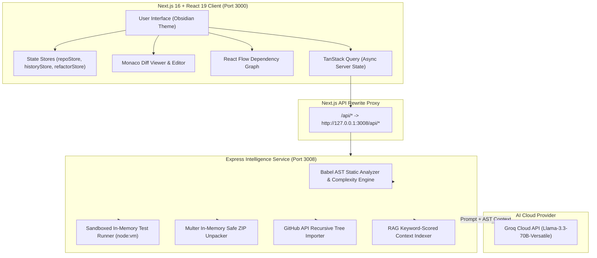

<div align="center">

# 🚀 PatchPilot (AI Code Refactoring & Intelligence Platform)

**An AI-Powered Code Intelligence, Architectural Review, Static Code Quality Analysis, and Automated Refactoring System.**

*Developed as a Major Academic Capstone Project in Software Engineering & Artificial Intelligence.*

---

[](https://nextjs.org/)
[](https://react.dev/)
[](https://www.typescriptlang.org/)
[](https://tailwindcss.com/)
[](https://groq.com/)
[](https://nodejs.org/)
[](LICENSE)

</div>

---

## 📌 Table of Contents

- [Overview](#-overview)
- [Project Highlights & Key Features](#-project-highlights--key-features)
- [System Architecture](#-system-architecture)
- [Technology Stack](#-technology-stack)
- [Directory Structure](#-directory-structure)
- [Preloaded Sample Codebases](#-preloaded-sample-codebases)
- [Getting Started](#-getting-started)
  - [Prerequisites](#prerequisites)
  - [Installation](#installation)
  - [Environment Configuration](#environment-configuration)
  - [Running the Application](#running-the-application)
- [API Reference](#-api-reference)
- [Core Methodologies & Academic Scope](#-core-methodologies--academic-scope)
- [Verification & Testing](#-verification--testing)
- [Roadmap & Future Enhancements](#-roadmap--future-enhancements)
- [Contributing & License](#-contributing--license)

---

## 📖 Overview

**PatchPilot** is a production-grade developer platform designed to tackle architectural degradation, security vulnerabilities, code smells, and technical debt in modern software systems.

In enterprise software engineering, legacy codebases accumulate hidden anti-patterns over time—including circular dependency chains, high cyclomatic complexity, deeply nested logic, hardcoded secrets, injection vectors, and untested refactor regressions. Manual refactoring is time-consuming, expensive, and prone to breaking existing application invariants.

PatchPilot solves this by combining:
1. **Deterministic Static AST Analysis** using `@babel/parser` for precise syntactical and architectural inspection.
2. **Generative AI Diagnostics & Refactoring** powered by Groq's high-throughput Llama-3.3-70B model.
3. **Interactive Architectural Dependency Graphs** built on React Flow (`@xyflow/react`) with circular cycle detection.
4. **Sandboxed In-Memory Test Execution** via Node.js `node:vm` to verify refactored code and prevent regressions before code changes are committed.
5. **Interactive Monaco Diff Studio** with RFC-compliant `.patch` generation and PR authoring.

---

## ✨ Project Highlights & Key Features

### 🔍 1. Multi-Dimensional AST Code Analysis
- **Abstract Syntax Tree (AST) Parsing**: Analyzes JavaScript and TypeScript files using `@babel/parser` to traverse nodes rather than relying solely on naive regex pattern matching.
- **Comprehensive Smell & Vulnerability Detection**:
  - **Complexity**: File line bloat, function line bloat (>45 lines), deep branch nesting (>3 levels), high cyclomatic complexity (>12 branches).
  - **Security**: Hardcoded production credentials (JWT secrets, API keys, DB URIs), unsafe `eval()` executions, un-sanitized child process / command execution, and SQL injection string concatenation.
  - **Performance**: In-loop asynchronous queries (N+1 database query antipattern).
  - **Architecture**: Multi-file circular import cycles and high module coupling.
  - **Duplication**: AST-level duplicated structural block detection.

### 📊 2. Dynamic Health Scoring & Telemetry Dashboard
- **Composite Score Engine**: Calculates a weighted score (0–100) and letter grades (**A** through **F**) across 4 key pillars:
  - Architecture Health (35%)
  - Security Posture (30%)
  - Code Complexity (20%)
  - Duplication & Modularity (15%)
- **Customizable Weights**: Configurable via the Settings module to align with individual team standards.
- **Rich Telemetry**: Interactive radial gauges, severity distribution charts, prioritized finding queues, and file explorer tables.

### 🕸️ 3. Interactive Architecture Graph & Dependency Tracing
- **Visual Node-Link Graph**: Powered by React Flow (`@xyflow/react`), mapping repository modules, internal file imports, and external package boundaries.
- **Cycle Detection (Tarjan's / DFS)**: Automatically highlights circular dependencies in warning red and outlines the exact call loop between files.
- **Coupling & Fan-Out Metrics**: Identifies central god-modules and architectural bottlenecks.

### ⚡ 4. AI-Powered Refactoring Studio (Monaco Editor)
- **High-Speed Inference via Groq**: Utilizes `llama-3.3-70b-versatile` with low latency for intelligent code refactoring.
- **Monaco Diff Viewer**: Side-by-side and inline unified diff views with syntax highlighting.
- **Quantitative Delta Metrics**: Measures and displays exact improvements in Cyclomatic Complexity and Lines of Code (LOC) before vs. after refactoring.
- **One-Click Patch & PR Generation**:
  - Export standard, RFC-compliant `.patch` files ready for `git apply`.
  - Preview generated GitHub-ready Pull Request descriptions.

### 🛡️ 5. Sandboxed In-Memory Test Execution (`node:vm`)
- **Safe Test Runner**: Executes repository test suites (`.test.js`, `.spec.js`) inside an isolated `node:vm` context with simulated Jest-style assertion harnesses (`describe`, `test`, `it`, `expect`).
- **Regression Detection**: Automatically runs tests against proposed refactored code. If tests fail post-refactor, flags regressions immediately and offers one-click rollback.

### 💬 6. Context-Aware Codebase Architect (RAG Chat)
- **Retrieval-Augmented Generation**: Indexes repository files and AST findings to provide answers grounded strictly in the loaded codebase.
- **Citations & Deep Linking**: Answers include direct file paths and line number references for immediate navigation.

### 📥 7. Flexible Ingestion & Workspace Management
- **Local ZIP Import**: Secure in-memory extraction with Zip-Slip path traversal protection (`..` path sanitation).
- **GitHub Repository Import**: Clones public GitHub repositories dynamically via GitHub REST API tree traversal.
- **Preloaded Sample Microservices**: Ready-to-evaluate real-world sample projects.

---

## 🏗️ System Architecture



---

## 💻 Technology Stack

| Layer | Technologies |
|---|---|
| **Frontend Framework** | [Next.js 16](https://nextjs.org/) (App Router), [React 19](https://react.dev/) |
| **Language** | [TypeScript](https://www.typescriptlang.org/) (Strict typing across domain models & AST nodes) |
| **Styling & Design System** | [Tailwind CSS v4](https://tailwindcss.com/), Lucide Icons, Obsidian Dark Palette |
| **Editor & Diff Engine** | [`@monaco-editor/react`](https://github.com/suren-atoyan/monaco-react), [`diff`](https://github.com/kpdecker/jsdiff) |
| **Graph Visualization** | [React Flow / `@xyflow/react`](https://reactflow.dev/) |
| **Client State Management** | [Zustand](https://zustand.docs.pmnd.rs/) with persistent local storage |
| **Data Fetching & Caching**| [TanStack React Query v5](https://tanstack.com/query/latest) |
| **Backend & Runtime** | [Node.js](https://nodejs.org/) (v18+ / v20+), [Express 5](https://expressjs.com/) |
| **AST Parser & Metrics** | [`@babel/parser`](https://babeljs.io/docs/babel-parser) |
| **Sandboxed Testing** | Node.js native [`node:vm`](https://nodejs.org/api/vm.html) |
| **AI Inference** | [Groq SDK](https://groq.com/) (`llama-3.3-70b-versatile`) |
| **File Processing** | [`jszip`](https://stuk.github.io/jszip/), [`multer`](https://github.com/expressjs/multer) |

---

## 📂 Directory Structure

```text
├── .env.example                 # Example environment variables template
├── package.json                 # Project scripts and dependencies
├── server.js                    # Express backend service (Port 3008)
├── next.config.js               # Next.js configuration
├── tsconfig.json                # TypeScript compiler configuration
├── public/                      # Static assets and icons
└── src/
    ├── app/                     # Next.js App Router pages
    │   ├── layout.tsx           # Global app layout & shell providers
    │   ├── globals.css          # Design tokens & Tailwind directives
    │   ├── dashboard/           # Code health metrics & overview
    │   ├── repositories/        # Repository workspace & manager
    │   ├── analysis/[id]/       # AST findings inspector
    │   ├── architecture/[id]/   # React Flow dependency graph
    │   ├── refactor/[id]/       # Monaco 3-panel refactoring studio
    │   ├── tests/[id]/          # Sandboxed VM test runner console
    │   ├── assistant/           # Full-page RAG architectural chat
    │   ├── history/             # Audit logs & rollback snapshots
    │   └── settings/            # Configurable scoring penalty weights
    ├── components/              # Modular UI components
    │   ├── layout/              # AppHeader, AppSidebar, CommandPalette
    │   ├── dashboard/           # HealthRadialGauge, MetricCards, ActivityFeed
    │   ├── repository/          # RepoImporterModal, ZipUploader
    │   ├── analysis/            # AnalysisWorkspace, FindingInspector
    │   ├── architecture/        # ArchitectureFlowGraph, CustomNode
    │   ├── refactor/            # RefactoringStudio, PRGeneratorModal
    │   ├── testing/             # TestRunnerConsole
    │   ├── assistant/           # AssistantChatDrawer
    │   └── ui/                  # Reusable Button, Dialog, Card primitives
    ├── services/
    │   ├── staticAnalyzer.ts    # Client & Server AST static analysis engine
    │   └── sampleRepos.ts       # Preloaded test-bed microservices
    ├── stores/                  # Zustand global state stores
    │   ├── repoStore.ts         # Active repository & analysis cache
    │   ├── refactorStore.ts     # Refactor proposals & diff state
    │   └── historyStore.ts      # Rollback points & audit logs
    └── types/                   # Unified TypeScript definitions
        ├── analysis.ts          # Metrics, circular dependencies, AST findings
        ├── issue.ts             # Code smell & security issue models
        ├── repository.ts        # Virtual repository & file representations
        └── refactor.ts          # AI refactoring proposals & diff payloads
```

---

## 🧪 Preloaded Sample Codebases

To facilitate immediate exploration without requiring external code uploads, PatchPilot includes three built-in benchmark projects:

1. **E-Commerce Microservice (`ecommerce-microservice`)**:
   - Production-style Node/Express checkout and user service.
   - Contains circular dependencies (`userService.js` ↔ `authService.js`), hardcoded credentials (`JWT_SECRET`, Stripe API keys), deeply nested order calculation routines, and unit tests (`checkout.test.js`).
2. **Task Management SaaS API (`saas-task-engine`)**:
   - Demonstrates high cyclomatic complexity, God-functions (>50 lines), repetitive utility logic, and N+1 loop database query anti-patterns.
3. **Auth & Identity Security Gateway (`auth-identity-gateway`)**:
   - Focuses on security inspection, containing SQL injection vulnerabilities via raw string interpolation, unsafe `eval()` executions, and command injection patterns.

---

## 🚀 Getting Started

### Prerequisites

Ensure you have the following installed on your workstation:
- **Node.js**: `v18.18.0` or higher (`v20.x` recommended)
- **npm**: `v9.x` or higher (or `pnpm` / `yarn`)
- **Groq API Key**: Obtain a free API key from [Groq Console](https://console.groq.com/keys)

### Installation

1. **Clone the repository**:
   ```bash
   git clone https://github.com/your-username/ai-code-refactoring-clg-major.git
   cd ai-code-refactoring-clg-major
   ```

2. **Install project dependencies**:
   ```bash
   npm install
   ```

### Environment Configuration

Copy the example environment file and insert your Groq API credentials:

```bash
cp .env.example .env
```

Edit `.env` to supply your configuration:
```env
# Server Port
PORT=3008

# Groq Cloud API Key
GROQ_API_KEY=gsk_your_groq_api_key_here
GROQ_MODEL=llama-3.3-70b-versatile

# Next.js Backend Proxy Target
BACKEND_API_URL=http://127.0.0.1:3008
```

> **Security Note:** Secrets such as `GROQ_API_KEY` are kept strictly server-side in Express and are never exposed to client-side bundles via `NEXT_PUBLIC_` prefixes.

### Running the Application

You can launch both the backend Express engine and the Next.js frontend concurrently using a single command:

```bash
npm run dev:all
```

Alternatively, you can run the services in separate terminal sessions:

```bash
# Terminal 1: Launch the Express Backend Engine (Port 3008)
npm run server

# Terminal 2: Launch the Next.js Frontend (Port 3000)
npm run dev
```

Open your browser and navigate to:
```
http://localhost:3000
```

---

## 📡 API Reference

The backend Express engine (`server.js`) exposes the following endpoints (automatically proxied by Next.js via `/api/*`):

| Method | Endpoint | Description |
|---|---|---|
| `GET` | `/api/health` | Verifies server status, Node.js version, and Groq SDK connectivity. |
| `POST` | `/api/upload-zip` | Safely unpacks uploaded `.zip` archives into virtual repository files in memory. |
| `POST` | `/api/github-repo` | Fetches file contents recursively from a public GitHub repository URL. |
| `POST` | `/api/explain-issue` | Requests a structured LLM diagnostic report (Root Cause, Security/Performance Impact, Remediation) for a specific AST issue. |
| `POST` | `/api/propose-refactor` | Generates refactored code using Groq LLM, calculates complexity deltas, and returns a unified Git patch. |
| `POST` | `/api/run-tests` | Runs test files inside an isolated `node:vm` sandbox and identifies regressions against proposed code changes. |
| `POST` | `/api/rag-chat` | Queries the codebase using keyword-scored contextual retrieval (RAG) with file citations. |
| `POST` | `/api/generate-patch` | Outputs RFC-compliant Git `.patch` file contents for immediate application with `git apply`. |

---

## 🔬 Core Methodologies & Academic Scope

This project addresses key theoretical and practical challenges in automated software engineering:

1. **AST Traversal vs. Heuristic Regex**:
   Regex pattern matching suffers from high false-positive and false-negative rates when analyzing variable scopes and nested blocks. PatchPilot parses source code into an Abstract Syntax Tree using `@babel/parser`, traversing function declarations, call expressions, and variable bindings to reliably measure McCabe Cyclomatic Complexity and identify security flaws.

2. **Automated Cycle Detection in Dependency Graphs**:
   Dependencies between modules form a directed graph $G = (V, E)$. PatchPilot applies Depth-First Search (DFS) cycle-finding algorithms to detect cycles ($u \to v \to \dots \to u$), pinpointing circular dependencies that impair modularity and tree-shaking.

3. **Sandboxed Regression Prevention**:
   AI-generated refactoring often introduces subtle runtime bugs or signature mismatches. PatchPilot executes unit tests inside an isolated Node.js `vm.Context` with mocked module loaders, evaluating the modified code against existing assertions before recommending approval.

4. **Multi-Factor Weighted Health Score**:
   Code health is calculated mathematically using penalty deduction models across four distinct domains:
   $$\text{Health Score} = 100 - \sum_{i} (w_i \times \text{penalty}_i)$$
   Where penalties are bounded and weighted by severity (Critical, High, Medium, Low).

---

## 🛠️ Verification & Testing

To lint and type-check the codebase:

```bash
# Run oxlint across the project
npm run lint

# Build production Next.js bundle
npm run build
```

---

## 🗺️ Roadmap & Future Enhancements

- [ ] **Multi-Language AST Support**: Expand parsing beyond JavaScript / TypeScript to Python (Tree-sitter) and Go.
- [ ] **Automated GitHub PR Bot**: GitHub App integration to post refactor suggestions directly on pull requests.
- [ ] **Babel Codemod AST Transforms**: Combine deterministic rule-based transforms with LLM semantic refactoring.
- [ ] **Local LLM Support (Ollama)**: Enable completely offline analysis using local models (e.g. `llama3`, `codellama`, `deepseek-coder`).

---

## 📄 License & Acknowledgements

- **License**: Distributed under the [MIT License](LICENSE).
- **Academic Context**: Developed as a Major Capstone Project exploring the intersection of Static Analysis, Generative AI, and Automated Software Maintenance.
- **Acknowledgements**: Powered by [Next.js](https://nextjs.org/), [Groq Cloud](https://groq.com/), [Babel](https://babeljs.io/), [React Flow](https://reactflow.dev/), and [Monaco Editor](https://microsoft.github.io/monaco-editor/).
